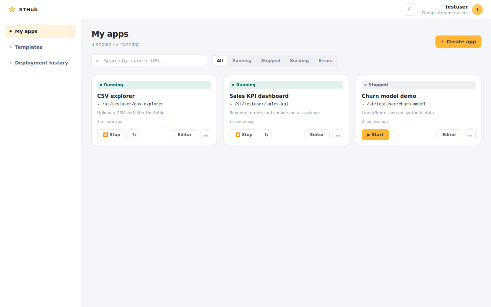

# STHub

[](https://github.com/tsrman/sthub-oss/actions/workflows/ci.yml)
[](LICENSE)

## What STHub does

STHub lets authenticated users create, edit, deploy, and host isolated Streamlit applications on one Docker host. Each app builds from its own `requirements.txt` and is published at `/st/{login}/{slug}`.

## Screenshot



A real authenticated dashboard from the local OSS stack, captured at 1440×900.

## Architecture

The browser uses a Next.js SPA, Keycloak OIDC, FastAPI, PostgreSQL, Redis/arq, a Docker worker, and Traefik. Only the worker controls Docker. See [architecture](docs/architecture.md).

## Requirements

- Docker Engine with Compose v2 (`docker compose version`).
- Free host ports `3001` (the app) and `8080` (Keycloak), both bound to loopback.
- About 6 GB of disk and 10–20 minutes for the first build: `streamlit-base` installs SciPy, PyArrow, scikit-learn, and Matplotlib.

For working on the code rather than running it, see [development](docs/development.md) — it also lists the Node.js and Python versions.

## Quick start

```bash
git clone https://github.com/tsrman/sthub-oss.git
cd sthub-oss
cp .env.example .env
docker build -t streamlit-base:latest ./streamlit-base
docker compose up --build -d
```

Open <http://localhost:3001>. Fixture accounts are **local-only**: `testuser` / `testpass` and `adminuser` / `adminpass`. Never reuse fixture passwords outside local development.

## Documentation

[Architecture](docs/architecture.md) · [Configuration](docs/configuration.md) · [API contract](docs/api-contract.md) · [Deployment](docs/deployment.md) · [Development](docs/development.md) · [E2E tests](e2e/README.md)

Design rationale for individual changes lives under `docs/designs/`, starting with [Streamlit base dependency security](docs/designs/2026-08-04-streamlit-base-dependency-security-design.md).

## Deployment scope

STHub supports one self-hosted Docker host. Kubernetes, Swarm, multi-host orchestration, and HA services are out of scope. See [deployment](docs/deployment.md).

## Security

Read [SECURITY.md](SECURITY.md); do not disclose vulnerabilities in public issues.

## Contributing

See [CONTRIBUTING.md](CONTRIBUTING.md) and [CODE_OF_CONDUCT.md](CODE_OF_CONDUCT.md).

## License

Copyright 2026 The STHub Authors.

STHub is licensed under the [Apache License, Version 2.0](LICENSE). You may use, modify, and distribute it under that license's terms. See [NOTICE](NOTICE) for attribution and [THIRD_PARTY_NOTICES.md](THIRD_PARTY_NOTICES.md) for redistributed components that carry their own obligations.
